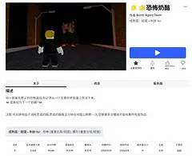
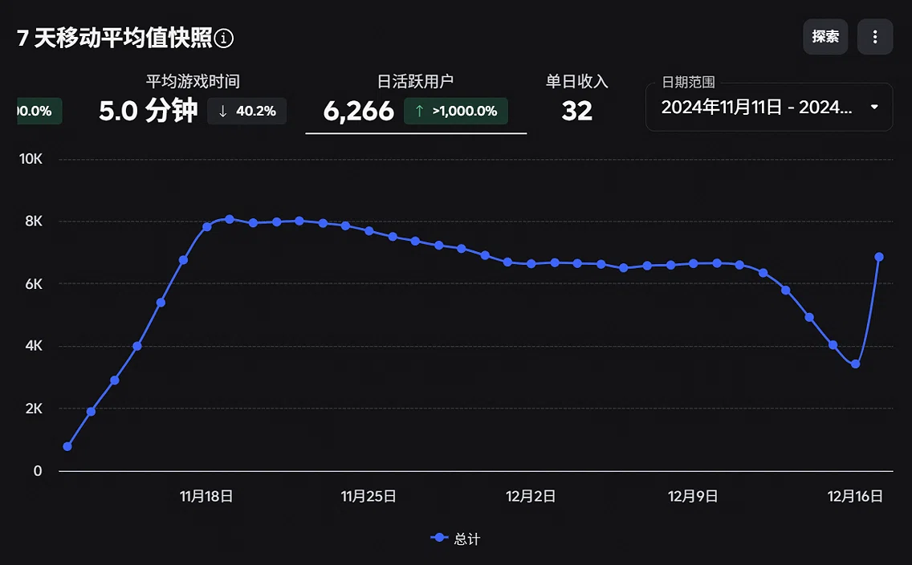

# 陈卓轩 · 技术策划 / 系统策划作品集

> 广东工业大学软件工程 2027 届。具备 Java 开发基础与线上游戏项目主策经验，擅长系统拆解、需求落地与跨职能沟通，致力于成为懂技术的策划。

📬 **联系方式**：15220637918 ｜ 1258081463@qq.com ｜ 微信：dusttt123
📄 **个人简历**：[点击查看/下载我的简历](doc/陈卓轩_游戏策划实习简历.pdf) 

---

## 🎮 核心项目 (Projects)

### 1. Roblox《恐怖奶酪》｜主策划 / 项目管理 (2024.09 - 2024.11)
与罗布乐思（Roblox）中国官方合作发行方联合开发及上线维护。
*   **数据表现**：累计访问量 **1460万+**，单日峰值 DAU **6,266**，平均游戏时长 **5.0 分钟**，收藏数 **5,368**。
*   
*   
*   **核心职责**：负责立项竞品分析、输出完整策划案、拆分程序美术需求表、组织周度发行方会议与管理需求变更。
*   🔗 [在线游玩链接](https://www.roblox.com/games/115928628149653/Horror-Cheese)

### 2. Minecraft Mod《ImaginationCraft 异想工艺》｜机制策划 / 协作开发 (2025.04 - 至今)
基于 Minecraft 1.21.1 NeoForge 框架的同人题材大型 Mod 合作开发项目。
*   **机制与开发**：负责玩家属性、怪物行为等机制设计；借助 AI 工具完成部分核心机制代码验证；预留接口以规范跨 Mod 兼容逻辑。
*   **工程与宣发**：使用 GitHub 协作（IDEA 变基提交）；独立录制剪辑演示视频投稿 B 站，累计获得 **2万+** 播放。
*   🎬 [B站演示视频](https://www.bilibili.com/video/BV1EjLgzjEGL/?spm_id_from=333.1387.homepage.video_card.click&vd_source=b53163b3bce1595df703eaed523710a5)

### 3. Roblox 官方 GameJam《编织 20》｜系统 / 关卡策划 (2024.05)
参与罗布乐思官方 29 小时限时主题 GameJam（“时光旅行”）。
*   **高光表现**：协调团队在 24 小时内完成原型开发；在广州赛区 8 支团队中脱颖而出，作为**唯二团队**获得向跨区赛场分享设计经验的机会。
*   🔗 [在线游玩链接](https://www.roblox.com/games/17688828222/sewing-24-years)

---

## 📝 游戏系统拆解 (System Teardowns)

> 展现对商业游戏底层机制、经济循环与体验痛点的深度剖析能力。

*   📄 **[《杀戮尖塔2（EA版）》构筑逻辑与生存压力拆解案](杀戮尖塔2构筑逻辑与生存压力拆解.md)**
    *   *核心观点*：通过对比一代，深入分析二代“回合限伤”、“商店删牌通胀”对玩家构筑路径的影响，探讨“防杀”逻辑与全面构筑的演变。

---

## 🛠 技能标签 (Skills)

*   **策划能力**：系统拆解、竞品分析、需求文档撰写、跨部门进度管理、数据驱动迭代。
*   **开发与工具**：Java、C、Git/GitHub、NeoForge Mod 开发、Linux 基础、熟练使用 AI 辅助开发。
*   **游戏理解**：5000+ 小时跨品类深度体验（卡牌 Roguelike、沙盒、动作），对系统循环与战斗数值有深入研究。
